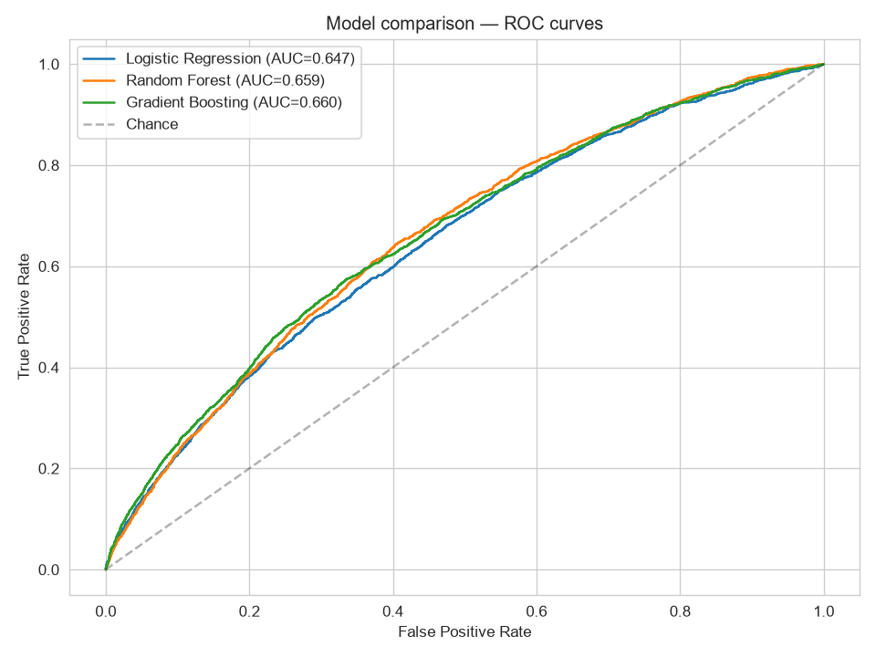
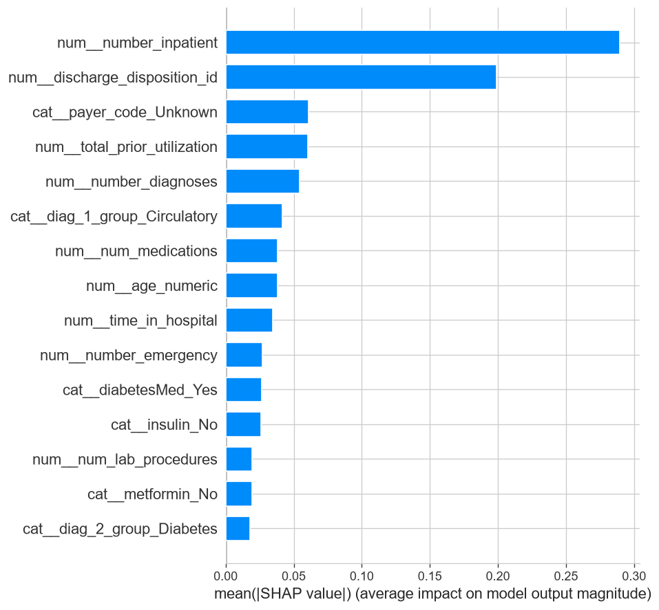

# Predicting 30-Day Hospital Readmission in Diabetic Patients

[](https://github.com/NERDfather/Diabetes-readmission-prediction/actions/workflows/ci.yml)

A classical machine learning project predicting whether a diabetic patient will be
readmitted to hospital within 30 days of discharge, using the
[Diabetes 130-US Hospitals (1999-2008)](https://archive.ics.uci.edu/dataset/296/diabetes+130-us+hospitals+for+years+1999-2008)
dataset from the UCI Machine Learning Repository.

## Why this problem matters

Hospitals in the US face financial penalties for high 30-day readmission rates
under the Hospital Readmissions Reduction Program. Being able to flag high-risk
patients before discharge lets care teams target follow-up resources where
they're most needed. This project treats it as a binary classification problem:
will this patient be readmitted within 30 days (`1`) or not (`0`)?

## Dataset

- ~101,766 hospital encounters for diabetic patients across 130 US hospitals, 1999-2008
- 50 raw features: demographics, admission/discharge details, diagnoses,
  lab results, medications, and prior utilization history
- Genuinely messy: missing values encoded as `"?"`, administrative ID columns
  requiring a separate lookup table, sparse ICD-9 diagnosis codes, and a
  known leakage trap (see **Data cleaning** below)

## Methodology

### 1. Exploratory data analysis
- Identified that `weight`, `max_glu_serum`, and `A1Cresult` are missing not
  at random — absence itself (e.g. "test not performed") carries signal
- Found `number_inpatient` (prior inpatient visits) to be the strongest
  single numeric predictor in raw EDA — readmitted patients averaged 1.22
  prior inpatient visits vs. 0.38 for those not readmitted
- Confirmed `discharge_disposition_id` includes codes for patients who died
  or were discharged to hospice — these encounters cannot be meaningfully
  "readmitted" and were excluded before modeling

### 2. Data cleaning
- Removed 2,423 encounters (2.4%) corresponding to expired/hospice discharge
- Recoded lab test results as an explicit `"Not tested"` category rather
  than imputing, preserving the missingness signal found in EDA
- Grouped sparse ICD-9 diagnosis codes into clinical categories
  (circulatory, respiratory, diabetes, etc.)
- Engineered `total_prior_utilization` (sum of prior outpatient, emergency,
  and inpatient visits)
- Dropped 15 medication columns that were >99% constant and added no signal

### 3. Modeling
- **Grouped, stratified train/test split** (`StratifiedGroupKFold`) to
  prevent the same patient's multiple encounters from leaking across
  train and test
- Addressed class imbalance (11.4% positive) via `class_weight="balanced"`
  / sample weighting rather than resampling
- Compared three model families on an identical split:

| Model | ROC-AUC | Recall (readmitted) | Precision (readmitted) |
|---|---|---|---|
| Logistic Regression | 0.655 | 0.54 | 0.17 |
| Random Forest | 0.662 | 0.53 | 0.18 |
| **Gradient Boosting** | **0.674** | 0.60 | 0.17 |

Gradient Boosting was selected as the final model based on the best AUC
and recall on the minority class.



### 4. Interpretation (SHAP)
Used SHAP to confirm the model learned clinically plausible patterns rather
than noise. Top predictors: prior inpatient utilization, discharge
disposition, total prior utilization, number of diagnoses, and diabetes
medication/insulin status — consistent with established clinical risk
factors for readmission.

**Caveat worth noting:** `payer_code` being missing ranked unexpectedly
high in feature importance. This may reflect administrative or
data-collection patterns (e.g. correlated with hospital site or
socioeconomic factors) rather than a direct clinical signal — a fairness
consideration that would need further investigation before any real-world
use.



## Results and limitations

An AUC of ~0.67 is consistent with published benchmarks on this dataset
and reflects a genuinely hard prediction problem: 30-day readmission
depends heavily on factors not captured in administrative/billing data
(e.g. social support, medication adherence, post-discharge complications).

At the default 0.5 threshold, the model catches ~60% of true readmissions
at the cost of many false positives (precision ~0.17). In a real deployment,
the decision threshold would be tuned against the actual cost of a missed
readmission vs. an unnecessary follow-up intervention — not left at a
default cutoff.

**This model is a portfolio/learning project, not a validated clinical
tool**, and should not be used for real patient care decisions without
substantial further validation.

## Intended Use & Limitations

**What this project demonstrates:** the full lifecycle of a classical ML
project — problem framing, EDA, leakage-aware data cleaning, model
comparison, interpretability, and deployment as a tested, containerized
API. That is its purpose: a portfolio piece showing these skills
end-to-end, not a finished clinical product.

**How the deployed API is meant to be used:** as a decision-support
signal for a human, not an automated decision-maker. A realistic
integration would surface the `risk_tier` field to a discharge nurse or
case manager alongside a patient's other information, to help prioritize
limited follow-up resources (e.g. a post-discharge phone call) toward
higher-risk patients — never to approve, deny, or automate any care
decision on its own.

**What would be required before any real-world use**, none of which
has been done here:
- Validation on data from the hospitals/population it would actually
  be used on (this dataset is US hospitals, 1999–2008 — outdated and
  not necessarily representative of any specific hospital today)
- Clinical and regulatory review (this is health-adjacent software;
  real deployment would involve compliance requirements like HIPAA
  and likely FDA considerations depending on how it's used)
- A fairness audit, given the unresolved `payer_code` finding above
- Threshold tuning done with clinical stakeholders against a real cost
  matrix, not the illustrative cutoffs used here
- Ongoing monitoring for model drift once in production

**In short:** treat the probabilities and risk tiers this API returns
as what they are — the output of a learning exercise — not as medical
advice or a validated risk assessment.

## Deployment

The final Gradient Boosting model is served as a FastAPI service,
containerized with Docker, and tested automatically on every push via
GitHub Actions CI. See [MLOPS.md](MLOPS.md) for the full architecture,
how to run it yourself, and the reasoning behind each deployment
decision (including why the trained model isn't committed to this repo,
and why the API reports two different risk thresholds).

## What I'd do with more time

- Tune the Gradient Boosting hyperparameters (currently default-ish) with
  proper nested cross-validation
- Investigate the `payer_code` finding further — check whether it's a
  hospital-site proxy and whether removing it changes fairness across
  patient subgroups
- Try threshold tuning against an explicit cost matrix
- Add authentication, request logging to a real database, and model
  drift monitoring to the deployed API (see MLOPS.md's "out of scope" section)

## Project structure

```
├── .github/workflows/
│   └── ci.yml                     # automated tests + Docker build on every push
├── data/
│   ├── diabetic_data.csv          # raw data (not included, see Setup)
│   └── diabetic_data_clean.csv    # cleaned data (generated by scripts)
├── eda_outputs/                   # plots generated during EDA and modeling
├── tests/
│   ├── generate_fixture_model.py  # throwaway model for CI (see MLOPS.md)
│   └── test_api.py                # API contract tests
├── 01_load_and_inspect.py
├── 02_eda.py
├── 03_clean_and_engineer.py
├── 04_baseline_model.py
├── 05_compare_models.py
├── 06_interpret_shap.py
├── 07_train_final_model.py        # trains + saves the deployed model
├── app.py                         # FastAPI serving layer
├── Dockerfile
├── requirements.txt                # for the ML/analysis scripts (01-06)
├── requirements_api.txt            # for the API (app.py)
├── MLOPS.md                       # deployment architecture & how to run it
└── README.md
```

## Setup

1. Download `diabetic_data.csv` and `IDs_mapping.csv` from the
   [UCI repository](https://archive.ics.uci.edu/dataset/296/diabetes+130-us+hospitals+for+years+1999-2008)
   and place them in a `data/` folder.
2. Install dependencies: `pip install -r requirements.txt`
3. Run the scripts in order (01 through 06).

## Author

Franklyn Epidi
